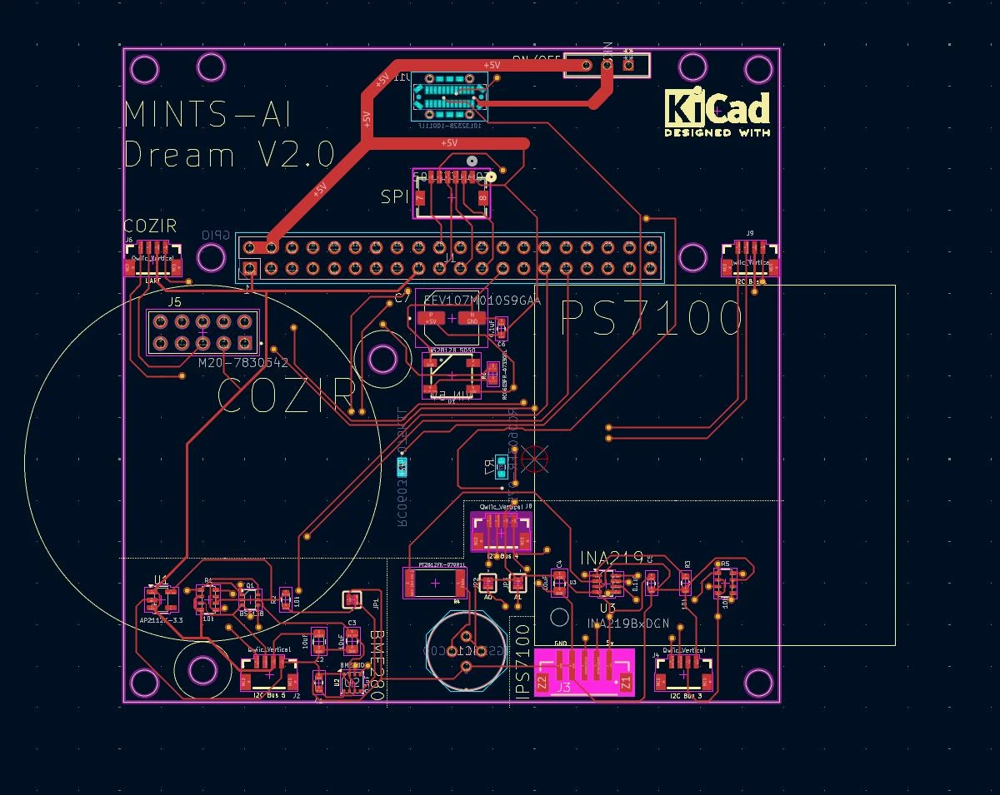
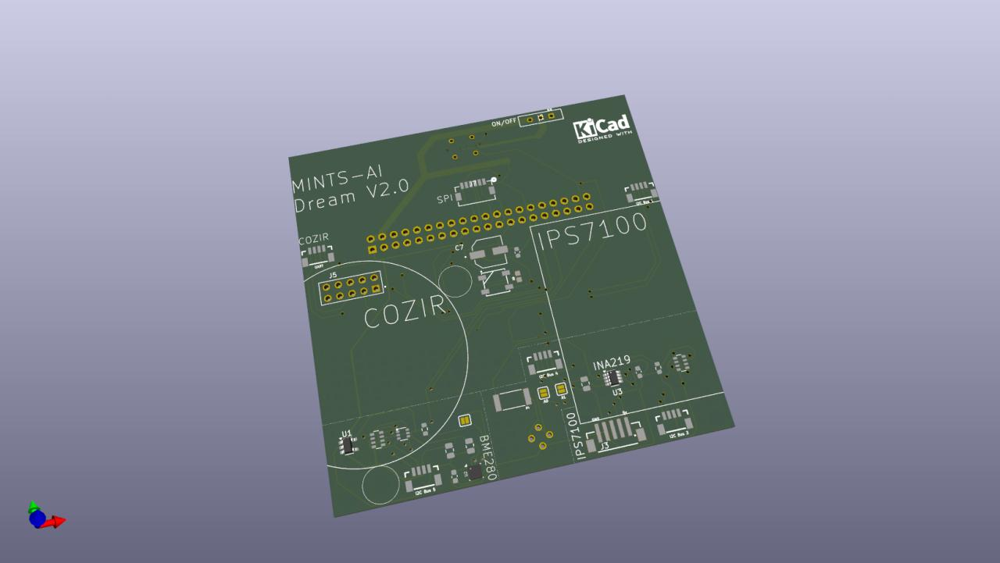

# MINTS-AI Dream V2.0

Dream V2.0 is a Raspberry Pi carrier board for the MINTS-AI environmental sensing nodes. It plugs onto the Pi's 40-pin GPIO header and brings together air-quality sensors, power monitoring and Qwiic expansion ports on a single board, so a full sensing node can be built from a Pi, this PCB and a few off-the-shelf sensor modules.

## What the board does

- **Gas and climate sensing** – an on-board Bosch BME280 (temperature, humidity, pressure) and a footprint for the Figaro TGS2611-C00 methane sensor.
- **CO₂ sensing** – a 10-pin header (J5) and outline for a COZIR CO₂ sensor, plus a UART Qwiic port (J6) for it.
- **Particulate sensing** – a 5-pin connector (J3) for the Piera Systems IPS-7100 particle sensor, with its outline on the silkscreen.
- **Power input and monitoring** – a USB-C receptacle (J11) supplies 5 V to the Pi and sensors through an ON/OFF pushbutton (S1). A TI INA219 with a 0.1 Ω shunt measures bus voltage and current over I²C.
- **Expansion** – five Qwiic (JST-SH 1 mm) connectors spread over separate Raspberry Pi I²C buses, and a 6-pin SPI header (J7).
- **Status** – one WS2812B addressable RGB LED.

## Main components

| Ref | Part | Role |
| --- | --- | --- |
| J1 | 2×20 2.54 mm socket | Raspberry Pi GPIO header |
| J11 | Amphenol 10132328-10011LF | USB-C power input (R6/R7 5.1 kΩ CC pull-downs) |
| S1 | NKK NK236 | ON/OFF pushbutton |
| C7 | Panasonic EEV107M010S9GAA | 100 µF bulk capacitor on 5 V |
| U1 | Diodes AP2112K-3.3 | 3.3 V LDO for the BME280 |
| U2 | Bosch BME280 | Temperature / humidity / pressure |
| Q1 | BSS138 (dual) | I²C level shifting for the BME280 |
| U3 + R4 | TI INA219BxDCN + 0.1 Ω 2512 shunt | 5 V current / power monitor |
| IC1 | Figaro TGS2611-C00 | Methane sensor |
| J5 | Harwin M20-7830542 | COZIR CO₂ sensor header |
| J3 | Würth 679305124022 | IPS-7100 particulate sensor connector |
| J2, J4, J6, J8, J9 | Qwiic vertical | I²C bus 5, 3, UART, 4, 1 |
| J7 | Molex 5013310607 | SPI header |
| D1 + R8 | WS2812B + 330 Ω | Status LED |
| JP1–JP3 | Solder jumpers | INA219 (A0/A1) and BME280 I²C address select |

The full bill of materials is in [`dreamV2_0_BOM.csv`](dreamV2_0_BOM.csv), and an interactive BOM is in [`bom/ibom.html`](bom/ibom.html).

## Files

| Path | Contents |
| --- | --- |
| `dreamV2.kicad_pro` | KiCad project (open this) |
| `dreamV2.kicad_sch` | Schematic |
| `dreamV2.kicad_pcb` | PCB layout |
| `dreamV2.step` | 3D model of the board (exported from an earlier layout revision) |
| `exports/`, `exports.zip` | Gerber and drill files |
| `nextpcb/`, `exports-NEXTPCB/` | NextPCB fabrication and assembly (BOM / CPL) files |
| `footprints/` | Footprint report |
| `dreamV2-backups/` | KiCad automatic project backups |

The fabrication outputs in `exports/` and `nextpcb/` still carry the old `dreamV1_0` file prefix. Regenerate them from `dreamV2.kicad_pcb` before ordering boards.

## Opening the project

Open `dreamV2.kicad_pro` in KiCad 9 or newer.
